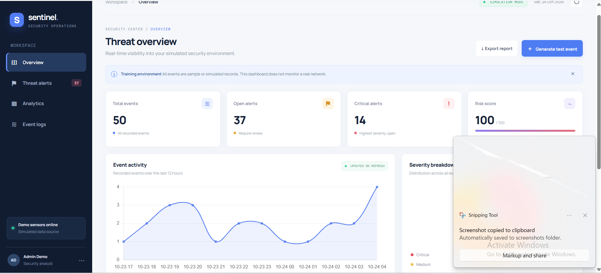

# CyberWatch — Cybersecurity Monitoring Dashboard

A cybersecurity monitoring dashboard built using Python, Flask, and SQLite.

## Dashboard Preview

## Features
- Security event monitoring
- Threat overview and alert cards
- Interactive charts
- Search and filtering
- Event investigation workflow
- CSV export

## Technologies Used
- Python
- Flask
- SQLite
- HTML, CSS, JavaScript

## Disclaimer
This project uses simulated security data for educational purposes only.
